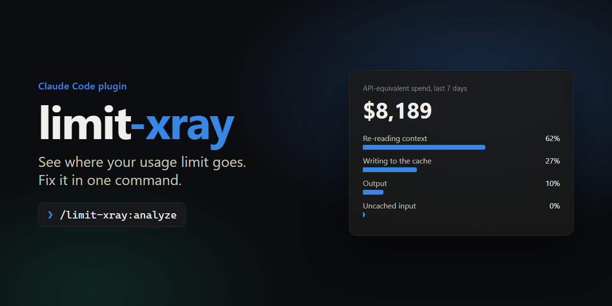
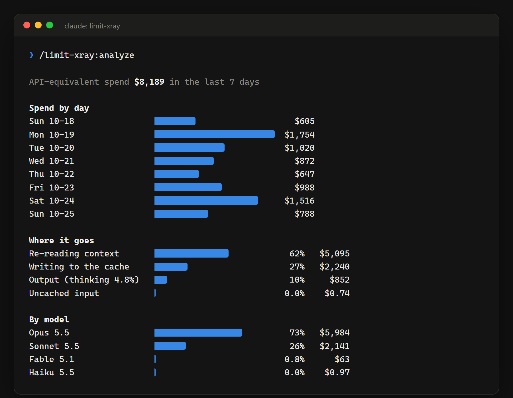
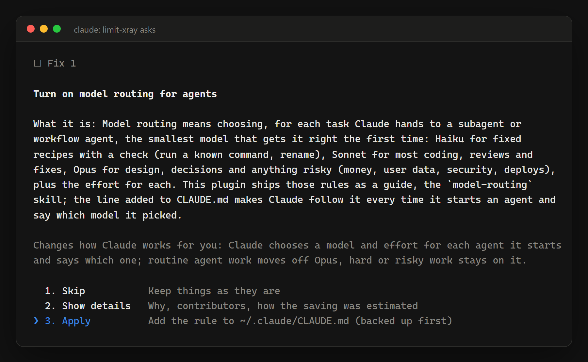
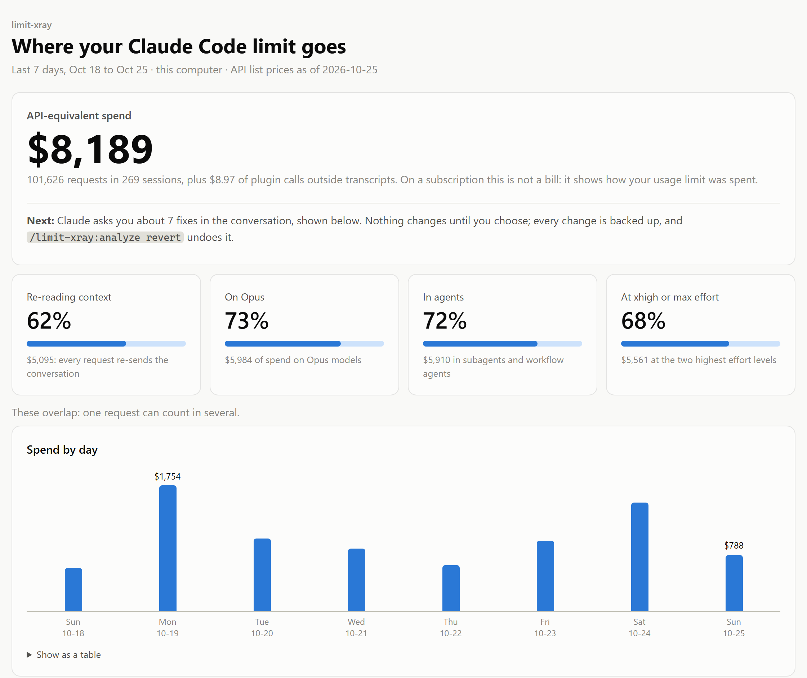
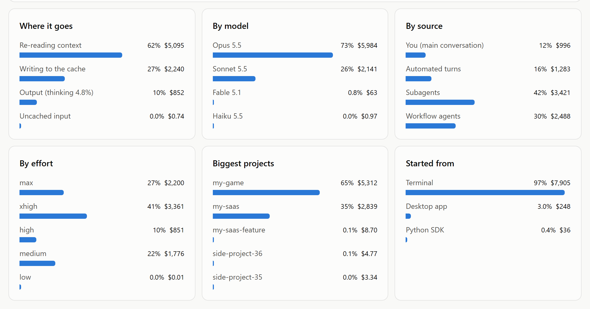
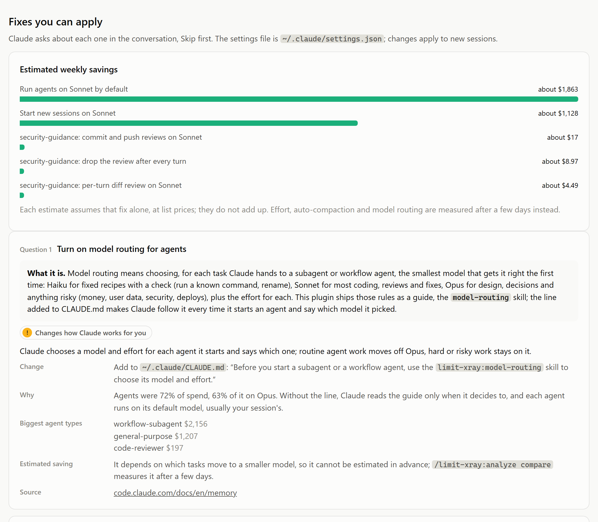
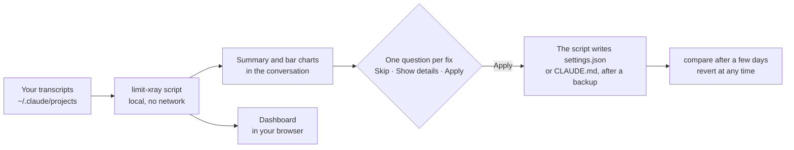

<div align="center">



<p>
  <a href="https://github.com/Wornax/limit-xray/actions/workflows/test.yml"></a>
  <a href="LICENSE"></a>
  
  
  
  
  
  
</p>

**An x-ray of your Claude Code usage limit: charts of where it goes, then one command to fix it.**

[Install](#install) · [What you get](#what-you-get) · [How it works](#how-it-works) · [Commands](#commands) · [Privacy](#privacy)

</div>

---

You keep hitting your Claude Code limit and nothing tells you why. limit-xray reads the transcripts Claude Code already keeps on your machine, prices every request at API list prices, and shows you, with charts, exactly what eats your limit: Opus where Sonnet would do, agents re-reading huge contexts, effort left at `xhigh`, loops, plugins. Then it asks about each fix, one question at a time, and applies only the ones you choose.

```text
/limit-xray:analyze
```

| | |
| :- | :- |
| 🔍 **X-ray** | Spend by day, by model, effort, source and project, and the findings behind it, as bar charts right in the conversation |
| 📊 **Dashboard** | The same numbers as a local page in your browser, light and dark, nothing loaded from the network |
| 🧭 **Model routing** | A guide that has Claude pick Haiku, Sonnet or Opus, and the effort, for every agent it starts |
| 🛠️ **One-command fixes** | Each fix says what it is, what it changes and what it should save; you choose, the script applies with a backup |
| ↩️ **Measure and undo** | Compare before and after a few days later; revert puts back exactly what it changed |
| 🌎 **Your language** | Charts, dashboard and every fix in English or Brazilian Portuguese, following Claude Code's `language` setting |

## What you get

<table>
<tr>
<td width="50%" valign="top"></td>
<td width="50%" valign="top"></td>
</tr>
<tr>
<td align="center"><sub>Bar charts right in the conversation</sub></td>
<td align="center"><sub>One question per fix, Skip first, every fix explained</sub></td>
</tr>
</table>

And a dashboard in your browser:

<picture>
  <source media="(prefers-color-scheme: dark)" srcset="docs/images/dashboard-overview-dark.png">
  
</picture>

<picture>
  <source media="(prefers-color-scheme: dark)" srcset="docs/images/dashboard-charts-dark.png">
  
</picture>

<picture>
  <source media="(prefers-color-scheme: dark)" srcset="docs/images/dashboard-fixes-dark.png">
  
</picture>

<sub>A real week of one heavy user, project and agent names changed. Dollars are API list-price equivalents: on a subscription they show how the limit was spent, not a bill.</sub>

## Install

Inside Claude Code:

```text
/plugin marketplace add Wornax/limit-xray
/plugin install limit-xray@limit-xray
```

Or from your shell, in one command (Claude Code 2.1.292 or later):

```bash
claude plugin install limit-xray --marketplace Wornax/limit-xray
```

Requires Node.js 18 or later on your `PATH`. No other dependencies.

## How it works



1. **Report.** A small local script reads your session transcripts, works out what each request would cost at API list prices, and shows what eats your limit. Finding out costs few tokens: the script does the math, and Claude only reads the short result.
2. **Model routing.** Claude asks whether to turn on `model-routing`, a skill shipped with the plugin: before it starts a subagent or workflow agent, Claude picks the smallest model that gets the task right the first time, and the effort the task needs (a log search at `low`, risky work at `high` or above). It is a three-line block in your `CLAUDE.md`.
3. **Fixes.** Then one question per settings fix that would help you. Each fix shows:
   - what it is, in plain words, for someone who has never heard of it;
   - whether it is "cost only" or "changes how Claude works for you", and how;
   - the change (the setting with its current and new value, or the line added to `CLAUDE.md`), and why;
   - the projects, agent types, sessions or plugin reviews behind it, when the transcripts can tell;
   - the weekly saving it estimates at list prices, and how. The estimates assume one fix at a time and do not add up; effort, auto-compaction and model routing are measured afterwards instead.

   A fix is offered only when your usage shows the problem and the change would take effect: not when your user settings or environment already have that value, outrank it, or switch the feature off. Alternatives, such as running the security-guidance per-turn review on Sonnet or dropping it, share one question, and the script refuses both together.
4. **Apply.** Before writing anything, Claude lists every change you chose and asks once more. The script, not Claude, writes them into your user `settings.json` and `CLAUDE.md`, after backing them up. The apply command also goes through Claude Code's own permission prompt (in auto mode the classifier may approve it instead).
5. **Other suggestions.** Habits such as `/clear` and `/compact`, and changes to your own agents and skills: slash commands are yours to type.
6. **Measure, undo.** After a few days of normal use, `/limit-xray:analyze compare` shows spend per active day and per request, and the share of each lens, before and after. `/limit-xray:analyze revert` puts back only what it changed, and leaves alone anything you changed since.

What it can change: the routing block in `CLAUDE.md`; in `settings.json`, `env.CLAUDE_CODE_SUBAGENT_MODEL`, per-model `effortLevel` under `modelSettings`, `autoCompactWindow`, `crossSessionInbound`, `fastMode`, `model`, and the security-guidance plugin's model variables. Records and backups live in `<config dir>/limit-xray/`.

## Commands

| Command | What it does |
| :- | :- |
| `/limit-xray:analyze` | Report on the last 7 days with charts and a dashboard, then ask about model routing and each fix, and apply the ones you choose |
| `/limit-xray:analyze compare` | Compare usage before and after the last change |
| `/limit-xray:analyze revert` | Undo the last change |
| `/limit-xray:report` | Report only, nothing asked or changed |
| `/limit-xray:report --days 30` | Longer window (1 to 90 days; Claude Code deletes transcripts after `cleanupPeriodDays`, 30 days by default) |
| `/limit-xray:report --project api` | Only projects whose folder name contains `api` |
| `/limit-xray:report --anonymize` | Replace project folder names, so you can share the report |
| `/limit-xray:model-routing` | Load the model-routing guide (Claude also loads it on its own before delegating) |

Claude runs `/limit-xray:analyze` on its own when you ask why you keep hitting your limit; `/limit-xray:report` runs only when you type it. Run either in a fresh session: the analysis adds a few thousand tokens of context.

**Language.** Reports, charts, the dashboard and the fix texts come in English or Brazilian Portuguese. The script follows Claude Code's `language` setting, from the project's settings or your own (`"language": "portuguese"` or `"pt"` gives Portuguese), and Claude passes `--lang pt` when you talk to it in Portuguese. Setting names and commands stay as they are in every language, and so does the routing line written to `CLAUDE.md`, which is an instruction for Claude.

<details>
<summary>Run the script directly, outside Claude Code</summary>

```bash
node plugins/limit-xray/scripts/limit-xray.mjs --days 7
node plugins/limit-xray/scripts/limit-xray.mjs --json > usage.json
node plugins/limit-xray/scripts/limit-xray.mjs analyze --open
node plugins/limit-xray/scripts/limit-xray.mjs apply model-routing-rule subagent-model-sonnet
node plugins/limit-xray/scripts/limit-xray.mjs compare
node plugins/limit-xray/scripts/limit-xray.mjs analyze --lang pt
```

`LIMIT_XRAY_NO_OPEN=1` keeps `analyze --open` from opening the browser. `--lang en|pt` picks the language; `LIMIT_XRAY_LANG` does the same for every run, and both win over the `language` setting.
</details>

## What it measures

| Lens | Why it matters |
| :- | :- |
| Re-reading context | Every request, including each tool call, re-sends the whole conversation. Cache reads are cheap per token, but at 500K tokens of context they dominate. |
| Subagents and workflow agents | Each agent has its own context and cache; long-running agents re-read their own growing context hundreds of times. |
| Effort | `xhigh` and `max` think longer and make more tool calls. |
| Models | Sonnet 5.5 lists at half the price of Opus 5.5. |
| Cache rebuilds | After a pause longer than the cache lifetime, or a model switch, the next request rewrites the whole prompt at the cache-write price. |
| Loops and automated turns | Loop firings, background-task notifications and messages from other sessions each re-read the conversation. |
| Setup at startup | Every new session and agent first writes its setup (system prompt, tools, CLAUDE.md, memory, skill descriptions) before doing any work. |
| Plugins that call the model | Sessions started by tools through the Agent SDK, plus plugin calls that never reach transcripts (read from the `security-guidance` log). |
| Fast mode | Fast mode bills Opus at twice the standard price; on a subscription it is paid from usage credits, not your plan limit. |

Lenses overlap: a subagent's cache reads count under both "Re-reading context" and "Subagents".

<details>
<summary>How the numbers are computed</summary>

- Reads `projects/**/*.jsonl` under `CLAUDE_CONFIG_DIR`, `~/.claude` and `~/.config/claude`, including subagent and workflow agent transcripts.
- **Counts each API response once.** Claude Code writes one transcript line per content block (thinking, text, tool call), each carrying the full usage of the response, the same `message.id` and a different `uuid`. Deduplicating by `(requestId, uuid)` counts a response once per block, about twice on real data; limit-xray deduplicates by `message.id`.
- Skips the lines it never needs (tool results, request blobs) from their first bytes without decoding them, so a heavy week of transcripts (several GB) takes well under a minute.
- Prices each response with the [API list prices](https://platform.claude.com/docs/en/about-claude/pricing) (cache writes by TTL, cache reads, thinking, fast mode, US-only inference, Haiku 5.5's long-prompt tier). The table's date is printed on every report.
- Every fix and setting is checked against the [Claude Code docs](https://code.claude.com/docs/en/costs), with a link in the plan.
</details>

## Privacy

- 🔒 **No network calls.** Everything stays on your machine.
- ✍️ **It writes only what you approve,** through the script: keys in your user `settings.json` and the routing block in your user `CLAUDE.md`, each backed up first. The one other file is its own dashboard page, `<config dir>/limit-xray/dashboard.html` (numbers and project names, never conversation text), which `analyze --open` opens in your default browser.
- 🙈 **No conversation text.** The report contains numbers, project folder names and short session ids (`--json` prints full session ids), never prompt, response or tool output text. `--anonymize` replaces folder names with `project-1`, `project-2`, and so on, and hides custom agent names and searched paths.
- 🧹 **Names from disk are cleaned** to plain characters before they reach the report or the dashboard, so a hostile file or folder name cannot inject text into the conversation.

## Limits

- The spend is **API-equivalent**: on a Pro, Max, Team or Enterprise plan it is not a bill, it shows how your usage limit was spent. Anthropic does not publish plan limits in tokens.
- It cannot see usage from other computers, claude.ai chat or Cowork, which share your plan limits, nor plugins and scripts that call the API without leaving a log it can read.
- The plan reads your user settings and environment; project and managed settings files also outrank the user file, and the plan does not read them.
- The transcript format is not a public API and may change between Claude Code versions.

## Contributing

- **A plugin that calls the model?** Add its log reader under `plugins/limit-xray/scripts/lib/plugins/`, or its first-prompt signature to `signatures.mjs`, with a test.
- **Prices changed?** Update `PRICES` and `PRICES_AS_OF` in `pricing.mjs`; the tests carry worked examples from the pricing page.
- **Another language?** Copy `plugins/limit-xray/scripts/lib/i18n/en.mjs`, translate every text keeping its values (`p.name`) and code spans, then in `i18n/index.mjs` import it into `CATALOGS` and give `langOf` a rule for its names. `tests/lang.test.mjs` checks that nothing is missing and no command changed.
- Run the tests with `npm test`. Tests use synthetic transcripts only: never commit real ones.

## License

[MIT](LICENSE)
